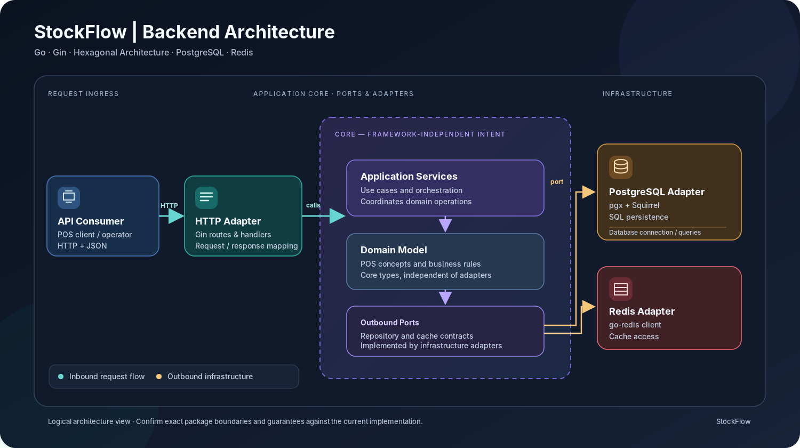
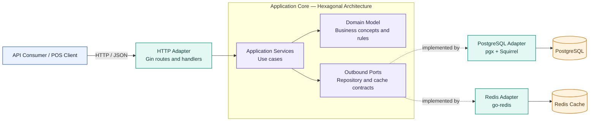

# StockFlow — Inventory & Point-of-Sale Backend

A Go-based REST API for point-of-sale workflows, organized around **Hexagonal Architecture (Ports and Adapters)**. The project uses Gin for HTTP routing, PostgreSQL for persistence, and Redis as a caching layer.

<p align="left">
  
  
  
  
  
  
</p>

> **Project status:** This repository is a customized continuation of the open-source [Go POS project](https://github.com/bagashiz/go-pos). The upstream implementation and its MIT license are acknowledged in [Credits & Attribution](#credits--attribution). The roadmap below distinguishes possible future improvements from functionality already described by the current codebase.

## Overview

StockFlow is a backend-focused POS service intended to demonstrate how a Go HTTP API can be structured so that transport, application logic, domain rules, and infrastructure concerns remain separated. The design keeps the core application independent of Gin, PostgreSQL, and Redis implementation details as far as the existing ports-and-adapters structure allows.

### Current technical scope

- **REST API:** HTTP endpoints implemented with [Gin](https://gin-gonic.com/).
- **Hexagonal architecture:** separation of application/domain concerns from inbound and outbound adapters.
- **PostgreSQL persistence:** database access through [`pgx`](https://github.com/jackc/pgx/), with [`Squirrel`](https://github.com/Masterminds/squirrel/) for SQL query construction.
- **Redis cache:** cache access through [`go-redis`](https://github.com/redis/go-redis/).
- **API reference:** Swagger documentation generated with [`swaggo`](https://github.com/swaggo/swag/) and served through [`gin-swagger`](https://github.com/swaggo/gin-swagger/).
- **Repeatable local setup:** Docker Compose and [Task](https://taskfile.dev/) workflows for dependencies, schema setup, migrations, and local development.

> Features such as authentication/RBAC, idempotent checkout, inventory locking, metrics, and CI should only be listed as implemented after they exist in this fork and have been tested. They are listed as possible enhancements in the roadmap, not as current capabilities.

## Architecture

The request path starts at the HTTP adapter. The application layer coordinates use cases and depends on domain contracts; infrastructure adapters provide the database and cache implementations. This keeps transport and storage concerns outside the core business logic.



<details>
<summary>View editable Mermaid architecture diagram</summary>



</details>

### Request lifecycle

1. A client sends an HTTP request to a Gin route.
2. The handler validates and translates the transport request into an application operation.
3. The application layer coordinates the use case and domain behavior.
4. Outbound ports are fulfilled by infrastructure adapters. PostgreSQL access uses `pgx` and Squirrel; cache access uses `go-redis`.
5. The handler maps the result to an HTTP response.

The diagram is a logical view of the architecture, not a claim about deployment topology or performance characteristics.

## Technology stack

| Area | Technology | Responsibility |
|---|---|---|
| Language | Go 1.23+ | Backend service and domain logic |
| HTTP | Gin | Routes, handlers, HTTP middleware |
| Database | PostgreSQL | Persistent application data |
| Driver / SQL builder | `pgx`, Squirrel | PostgreSQL connectivity and query construction |
| Cache | Redis, `go-redis` | Caching layer |
| API documentation | `swaggo`, `gin-swagger` | Swagger specification and browser UI |
| Local environment | Docker Compose | Local dependencies and services |
| Task runner | Task | Development and setup commands |

## Repository layout

```text
.
├── cmd/http/            # HTTP service entry point
├── internal/            # Application implementation and internal packages
├── docs/                # API documentation and architecture assets
├── .devcontainer/       # Optional development-container configuration
├── .env.example         # Example environment configuration
├── Dockerfile           # Container build definition
├── docker-compose.yml   # Local service orchestration
├── Taskfile.yml         # Common development tasks
├── schema.dbml          # Database schema source
└── README.md
```

Directory contents can evolve as the project is extended; consult the repository for the current package-level layout.

## Getting started

### Prerequisites

- Go **1.23 or newer**
- [Task](https://taskfile.dev/installation/)
- Docker with Docker Compose

Verify your local tools:

```bash
go version
task --version
docker --version
docker compose version
```

### 1. Clone the repository

```bash
git clone https://github.com/jp7107/StockFlow-go-pos.git
cd StockFlow-go-pos
```

### 2. Configure the environment

```bash
cp .env.example .env
```

Open `.env` and set the values required by your local environment. Do not commit real credentials, access tokens, or production secrets.

### 3. Initialize dependencies and database

```bash
task
```

The project’s default Task workflow is intended to install dependencies, start the Docker Compose services, prepare the schema, and run database migrations. Review `Taskfile.yml` if your local environment needs different steps.

### 4. Start the service

```bash
task dev
```

Use the application logs to confirm startup and verify the configured port. With the default configuration, the Swagger UI is documented at:

```text
http://localhost:8080/docs/index.html
```

If your `.env` changes the port or documentation route, use the configured address instead.

## API documentation

- **Swagger UI (local):** `http://localhost:8080/docs/index.html`
- **API definition and generated docs:** see the `docs/` directory.
- **Database schema reference:** [Go POS schema on dbdocs.io](https://dbdocs.io/bagashiz/Go-POS/)

Use the API specification and implementation together when exploring endpoints; this README intentionally does not invent routes or request/response schemas that are not listed here.

## Development workflow

List the tasks supported by the project:

```bash
task --list
```

Run the Go test suite where the relevant dependencies and environment are configured:

```bash
go test ./...
```

Before submitting changes, check formatting and run the checks available in the repository:

```bash
gofmt -w .
go vet ./...
```

`gofmt -w .` changes Go source files in place. Review `git diff` afterwards and avoid formatting generated files unnecessarily.

## Engineering roadmap

The following are **candidate enhancements**, not a claim that they are already implemented. Complete and test them before moving them into the current-capabilities section.

- [ ] Add integration tests for API handlers and PostgreSQL-backed workflows.
- [ ] Define and enforce authentication and role-based authorization if required by the product scope.
- [ ] Make critical stock/order updates transaction-safe and add concurrency tests.
- [ ] Add idempotency for operations that may be retried by clients.
- [ ] Add structured request logging, health/readiness endpoints, and service metrics.
- [ ] Add CI checks for formatting, tests, static analysis, and container builds.
- [ ] Document error response formats, endpoint examples, and configuration variables.

## Production-readiness checklist

Before operating this service with real users or business data:

- Store secrets in a secret manager or deployment environment, not in source control.
- Restrict PostgreSQL and Redis network access and use credentials appropriate to the environment.
- Put public traffic behind HTTPS and configure allowed origins if browser clients are used.
- Apply request timeouts, input validation, resource limits, and rate controls appropriate to the deployment.
- Verify transaction boundaries for stock and sales operations and test concurrent requests.
- Configure backups, migration review, logs, health checks, alerts, and a rollback procedure.
- Run tests and dependency/security checks against the exact version you deploy.

This checklist describes deployment work to verify; it does not certify that every item is currently implemented.

## Credits & attribution

This repository is based on and extends the open-source [**Go POS** project by `bagashiz`](https://github.com/bagashiz/go-pos). The upstream repository describes itself as a learning-oriented proof of concept for Hexagonal Architecture in Go and uses Gin, PostgreSQL (`pgx` and Squirrel), and Redis (`go-redis`).

The original project was also inspired by [Asdita Prasetya’s backend portfolio project video](https://www.youtube.com/watch?v=uAR1kjyeDtg). Useful architecture references include:

- [Hexagonal Architecture — Alistair Cockburn](https://alistair.cockburn.us/hexagonal-architecture/)
- [Ready for changes with Hexagonal Architecture — Netflix Technology Blog](https://netflixtechblog.com/ready-for-changes-with-hexagonal-architecture-b315ec967749)
- [Hexagonal Architecture in Go — Matias Varela](https://medium.com/@matiasvarela/hexagonal-architecture-in-go-cfd4e436faa3)

Please retain the upstream license and copyright notices as required by the MIT License, and describe your own modifications accurately in the commit history and resume.

## License

The upstream project is distributed under the [MIT License](LICENSE). Review the license file included in this repository before redistributing modified versions.

---

<p align="center">
  <sub>StockFlow — Go backend engineering project focused on maintainable API architecture and POS workflows.</sub>
</p>
